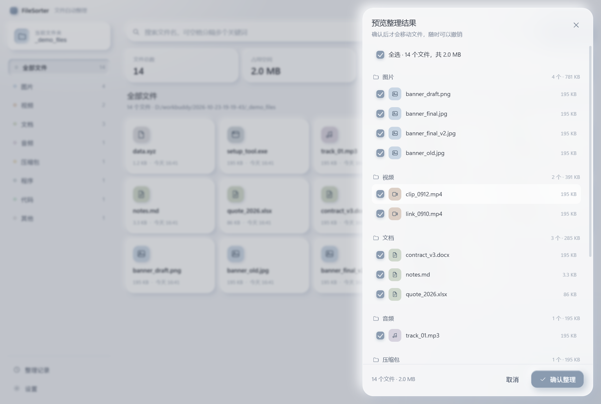

# FileSorter

> 轻量级 Windows 桌面文件自动整理工具：一次点击，把下载文件夹里的东西各归各位。
> A lightweight desktop file organizer for Windows — auto-classify, preview, search.


---

## 为什么做这个

下载文件夹永远是乱的。系统自带的「按类型分组」只能看、不能动，市面上的整理工具要么捆绑全家桶，要么在你的文件夹里塞一堆用不上的订阅功能。

FileSorter 只做一件事：**把散落的文件按类型归到对应的子文件夹，并且在动手之前先让你看清楚要发生什么**。

- 免安装，单文件 exe，不需要管理员权限
- 完全离线，文件不离开你的电脑，没有任何网络请求
- 先预览后执行，做完还能一键撤销
- 开源 MIT，代码结构简单到可以一晚上读完

## 功能

### 自动分类整理

选中文件夹（比如「下载」或「桌面」），扫描里面的文件，按扩展名归入八类子文件夹：

| 分类 | 默认文件夹 | 覆盖的扩展名 |
| --- | --- | --- |
| 图片 | `图片` | jpg jpeg png gif webp bmp svg ico tif heic avif psd … |
| 视频 | `视频` | mp4 mkv avi mov wmv flv webm m4v mpg ts rmvb … |
| 文档 | `文档` | pdf doc docx txt md rtf xls xlsx ppt pptx csv epub … |
| 音频 | `音频` | mp3 flac wav aac ogg m4a wma ape opus … |
| 压缩包 | `压缩包` | zip rar 7z tar gz bz2 xz iso cab … |
| 程序 | `程序` | exe msi bat cmd apk appx dmg pkg jar … |
| 代码 | `代码` | py js ts tsx cpp c h java go rs php html css json yml … |
| 其他 | `其他` | 无扩展名或以上都不匹配的文件 |

### 预览模式



点「预览整理」不会动任何文件，只列出将要发生的事：哪个文件、去哪个文件夹、有没有重名、一共多大。可以逐个取消勾选，只整理你想整理的那部分。

### 自定义文件夹名


八个分类的文件夹名称都能改，比如把「图片」改成「照片」。**改的只是文件夹叫什么，归类规则一点没变**。留空则回退默认名。

### 全局搜索 + 相似推荐

顶部搜索框对当前文件夹做递归搜索，支持空格分隔的多个关键词（AND 语义）。命中后下方自动推荐 3~5 个相似文件，打分维度是：

```
同前缀词      +5   banner_final.jpg ↔ banner_old.jpg
同扩展名      +3
修改时间 <24h +2   （<7 天 +1）
体积相差 <15% +1
同目录        +1
```

单击卡片在资源管理器中定位文件，双击直接打开。`Ctrl + K` 随时聚焦搜索框。

### 撤销

每次整理都会写一份逐行落盘的日志（NDJSON），点「撤销」按逆序把文件搬回原位。进程中途被杀也只丢最后一条，不会出现「日志说有、实际没移」。

## 12 条动画原则的落地

界面动效不是随手加的 `transition`，而是把迪士尼 12 条动画原则逐条对应到具体交互上。所有实现集中在 `src/renderer/js/motion.js`，函数注释里标了原则编号：

| # | 原则 | 在 FileSorter 里 |
| --- | --- | --- |
| 1 | Squash & Stretch 挤压拉伸 | 卡片点击回压时纵向压扁 6% 再弹回 |
| 2 | Anticipation 预期 | 「撤销」按下先沉降 1.5px、120ms 后才执行 |
| 3 | Staging 舞台呈现 | 卡片飞向分类时，其余卡片虚化后退 |
| 4 | Pose to Pose 关键帧 | 飞行动画显式给出起、中、落三帧 |
| 5 | Follow Through 跟随 | 卡片入场按 26ms 递增延迟，后进者尾随 |
| 6 | Slow in & Out 缓入缓出 | 统一 `cubic-bezier(.22,.61,.36,1)` |
| 7 | Arcs 弧线 | 飞行轨迹抬高成二次贝塞尔弧，不走直线 |
| 8 | Secondary Action 次要动作 | 落点处分类色点轻跳、统计数字滚动 |
| 9 | Timing 节奏 | 六档时长 80/120/180/240/320/420ms |
| 10 | Exaggeration 夸张 | 完成后数字过冲到 1.08 倍再回落 |
| 11 | Solid Drawing 立体感 | 指针移动时高光跟着走，物体不动光在动 |
| 12 | Appeal 吸引力 | 4px 栅格、莫兰迪蓝灰、单次动效不超 420ms |

风格基调是**拟态玻璃（Neumorphic Glass）**：米白冷灰底 + 半透明白玻璃 + 双向柔和阴影（右下冷灰、左上纯白）+ 1px 白色内描边。全部色值与阴影定义在 `styles/tokens.css`，组件层不写死数值。

尊重系统偏好：`prefers-reduced-motion` 下全部动效降为瞬时；设置里也可以把动效切成「轻柔」或「关闭」。

## 安装

### 直接使用

到 [Releases](../../releases) 下载 `FileSorter-1.0.0-x64.exe`，双击安装。安装向导允许自选目录，不需要管理员权限。

### 从源码运行

```bash
git clone <your-repo-url> FileSorter
cd FileSorter
npm install
npm start
```

要求 Node.js ≥ 20。

## 使用

1. 点左上角「当前文件夹」，选择一个目录（默认记住上次的选择）
2. 看一眼右侧统计：文件总数 / 占用空间 / 待归类 / 已归档
3. 点「预览整理」，勾选要处理的文件
4. 点「确认整理」——文件开始归类，可以随时点「撤销」

整理过程中同步在做的：

- `.part` `.crdownload` `.tmp` `~$` 开头的下载中 / 临时文件一律跳过
- 点开头的隐藏文件按设置决定是否跳过
- 目标文件夹有同名文件时自动加序号 `a(1).jpg`，**绝不覆盖**
- 文件被其他程序独占时跳过并在提示里说明

## 技术架构

```
Electron 主进程                    渲染进程
┌──────────────────────┐          ┌───────────────────────┐
│ classifier  分类规则 │          │ views/  三个视图      │
│ scanner     扫描统计 │  IPC     │ motion  动效引擎      │
│ organizer   计划/执行│◄────────►│ components 卡片/提示  │
│ search      搜索打分 │ 白名单   │ app.js  状态与事件    │
│ undo        日志/回滚│          └───────────────────────┘
│ store       设置持久化│
└──────────────────────┘
```

**分类规则只有一份**（`src/main/classifier.js`）。渲染层不复制这张表，分类名称、图标、扩展名全部经 IPC 下发，所以「设置里改名」和「整理时归类」永远一致。

### 安全设计

- `contextIsolation: true` + `sandbox: true` + `nodeIntegration: false`，渲染进程拿不到 `require`
- 所有主进程能力经 preload 用 `contextBridge` 暴露成具体动作，**不能拼接通道名**
- 每个 IPC 通道都校验入参：路径必须是绝对路径；`execute` 只接受**纯文件名**，带 `/` 或 `\` 的输入直接丢弃，渲染层无法构造任意路径
- CSP 限制为 `default-src 'none'`，只允许加载自身脚本与样式
- 外链一律交给系统浏览器，窗口本身禁止导航
- 全程零网络请求

### 目录结构

```
FileSorter/
├─ src/
│  ├─ main/          主进程
│  │  ├─ index.js        窗口、单实例锁、冒烟探针
│  │  ├─ ipc.js          IPC 路由与入参校验
│  │  ├─ classifier.js   分类规则（唯一数据源）
│  │  ├─ scanner.js      递归扫描、分批 stat、统计
│  │  ├─ organizer.js    buildPlan / executePlan
│  │  ├─ search.js       搜索与相似度打分
│  │  ├─ undo.js         NDJSON 日志与回滚
│  │  ├─ store.js        设置原子写
│  │  └─ fsutil.js       移动/占用检测/重名处理
│  ├─ preload/       桥接层（白名单 API）
│  └─ renderer/      界面
│     ├─ index.html
│     ├─ styles/     tokens · glass · layout
│     └─ js/         app · motion · api · views/ · components/
├─ test/             node:test 单测
├─ scripts/          图标生成、冒烟截图
├─ build/            图标资源
└─ electron-builder.yml
```

## 开发

```bash
npm start                 # 开发运行
npm test                  # 单元测试（分类 / 规划 / 搜索 / 撤销）
npm run smoke             # 冒烟：启动、截图、打印渲染层报错后退出
npm run smoke -- --smoke-step=preview   # 可选 preview / settings / history / organize / undo
npm run dist              # 打 Windows 安装包
```

冒烟模式参数：

```bash
npx electron . --smoke --capture=out.png [--smoke-step=preview]
```

## 已知限制

- 只归类**当前目录的第一层文件**，不会递归整理子文件夹里的东西（搜索和统计会递归）
- 隐藏文件按「点开头」判断，读不到 Windows 的隐藏属性
- 跨盘移动走「复制 + 删除」，大文件会比较慢；同盘是瞬时改名
- 撤销只搬回文件，不会删除整理后留下的空文件夹
- 仅支持 Windows（用的是 NSIS 打包与 Windows 路径规则）

## 贡献

欢迎 Issue 和 PR。提交前请确认：

1. `npm test` 全绿
2. 新增分类请只改 `src/main/classifier.js`，不要在渲染层复制规则
3. 涉及文件操作的新逻辑，请补一条覆盖失败路径的单测
4. 动效改动请说明影响了 12 条原则里的哪一条

## License

[MIT](LICENSE) © 2026 FileSorter Contributors
