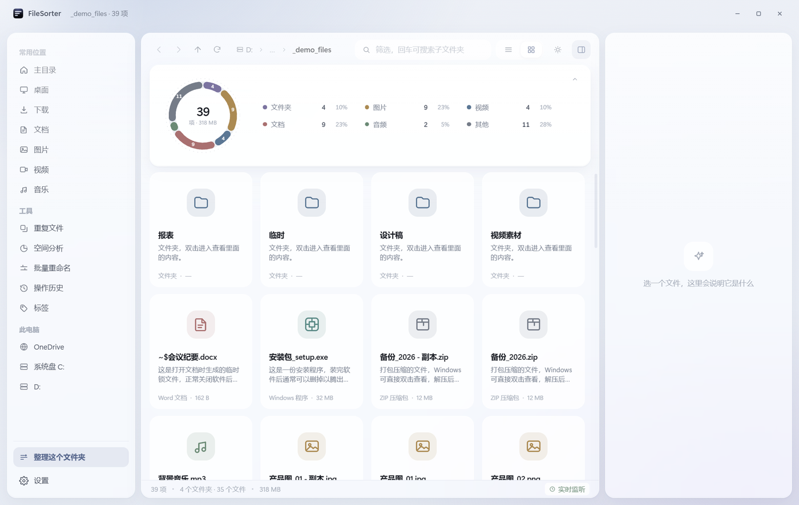
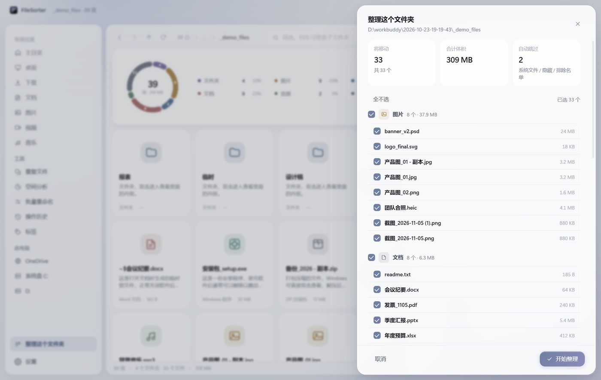
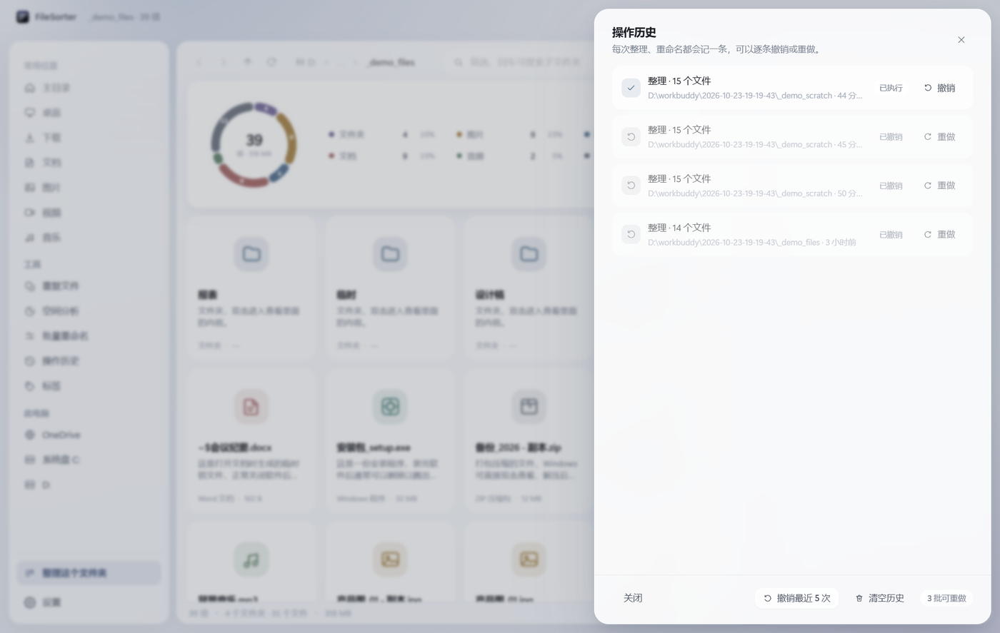
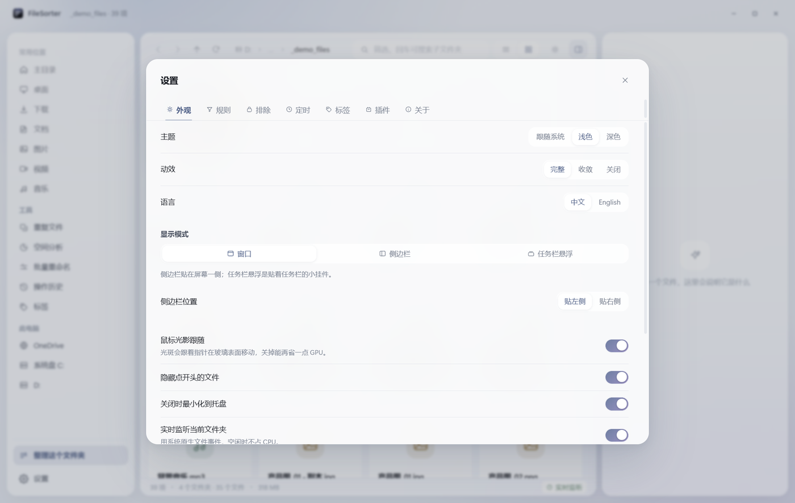
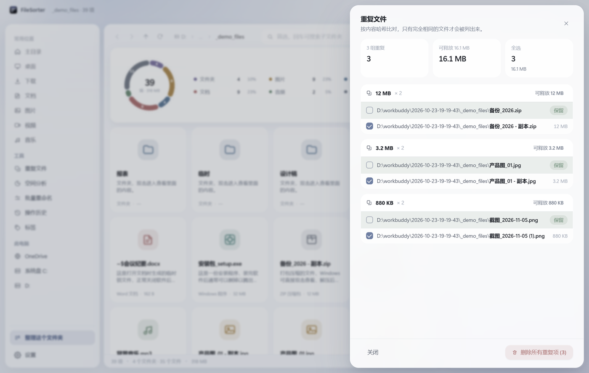
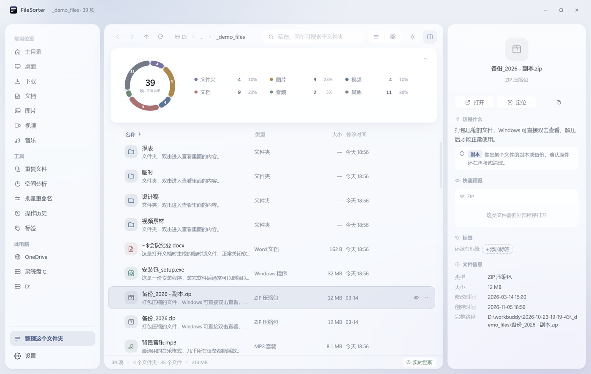
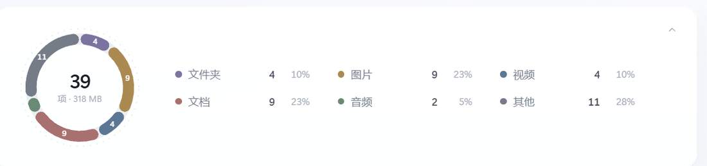
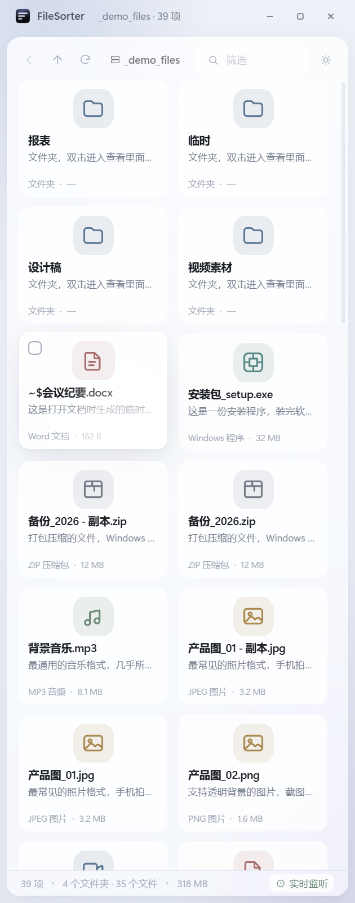
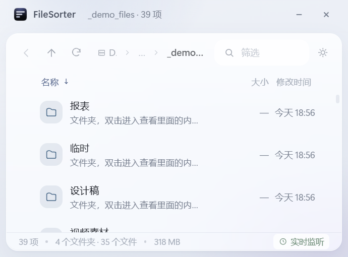

# FileSorter

**一个把「文件整理」做安全的 Windows 桌面工具。**

选一个文件夹，它告诉你哪些文件会被挪到哪，你勾掉不想动的，确认后执行；后悔了随时撤销，连撤多步也行。
顺便它还认得 140+ 种扩展名、能查重、能打标签、能预览、能打包加密。

<p align="center">
  
</p>



---

## 为什么值得用

大多数「一键整理桌面」的工具都有一个共同问题：**它敢动你的文件，你不敢让它动。**

FileSorter 的设计从头到尾围绕一件事——**让「误整理」这件事不可能发生，发生了也能完整退回**：

| 你会担心的事 | 它的应对 |
|---|---|
| 它偷偷把文件挪走了 | 永远先出预览，逐条可取消勾选，确认才执行 |
| 系统文件、隐藏文件被动 | 两层闸：系统文件硬保护（用户删不掉）+ 你自己的排除名单 |
| 整理完发现不对，回不去了 | 每次操作都写日志，支持**多步撤销**，撤销后还能**重做** |
| 撤销完了目录里一堆空文件夹 | 撤销时自动收掉本次腾空的分类目录，非空的绝不动 |
| 同一批文件改名互相覆盖 | 两阶段改名（先临时名再落名），`a→b, b→a` 也不会丢 |

除此之外，它是个称职的文件浏览器：分类轮盘、三栏布局、虚拟滚动、深浅主题、全局搜索、实时监听。

---

## 核心功能

### 整理：先看得见，再动手



- **先预览**：三张指标卡（将移动 / 合计体积 / 自动跳过），按目标文件夹分组列出每个文件，单条可取消勾选，整组也能一键全不选
- **八类归类**：图片 / 视频 / 文档 / 音频 / 压缩包 / 程序 / 代码 / 其他，分类名和扩展名都能在设置里改
- **自动跳过**：系统文件、隐藏文件、下载中的 `.crdownload/.part`、你排除名单里的项，都会在预览里标出来并说明原因
- **重名不覆盖**：目标位置已有同名文件时自动追加 `(1)`，被占用（正被其他程序打开）的跳过并提示

### 撤销：多步、可重做、不留残渣



- 每次整理、重命名、打包都会记一条日志（NDJSON 逐行追加，进程被杀最多丢最后一条）
- 支持撤销最近 N 批，不只是"上一次"
- 撤销 = 日志文件后缀从 `.jsonl` 改成 `.undone` 的一次原子改名，不存在"按钮说撤销了、实际没撤"的中间态
- 想反悔可以重做，重做后再撤销仍然有效
- **撤销会把本次整理腾空的分类目录一起收掉**——空壳目录用非递归 `rmdir` 删除，非空则原样保留

### 自定义分类规则：不止看后缀



- 五个字段：文件名 / 扩展名 / 文件大小 / 修改时间 / 创建时间
- 十余种条件：包含、不包含、等于、匹配正则、大于、小于、介于、在最近 N 天、早于 N 天
- 一条规则内多条件是 **AND**，规则之间**从上到下匹配、第一条命中即生效**（顺序即优先级，可拖动调整）
- 目标文件夹支持占位符：`{yyyy}` `{yy}` `{mm}` `{dd}` `{ext}` `{type}` `{first}`，写 `/` 就是多级目录，例如 `截图/{yyyy}-{mm}`
- 典型用法：文件名含「笔记」→ 进 `笔记` 文件夹；大于 100MB → 进 `大文件/{yyyy}-{mm}`

### 排除名单：给重要目录上锁

- 四种匹配方式：精确文件名、包含关键词、通配符（`*.tmp`）、绝对路径（含其下所有子目录）
- 系统文件（`desktop.ini`、`Thumbs.db`、`pagefile.sys`、Office 的 `~$` 锁文件…）与系统目录（`$RECYCLE.BIN`、`node_modules`、`.git`…）是**写死的硬保护**，清空排除名单也照样拦住
- 自带默认名单：`*.tmp`、`*.log`、`~$*`、`node_modules`、`.git`

### 定时整理：说好几点就几点

- 每天 / 每周，可指定目录，可设静默模式（只写日志不弹窗）
- 用的是**单次 `setTimeout` 精确排到下次触发时刻**，不是每秒轮询检查"到点了吗"
- 改设置会立刻重排下一次触发时间，不用重启

### 实时监听：原生事件，不轮询

- 基于 chokidar，底层是 Windows 的 `ReadDirectoryChangesW`，`usePolling: false` 显式关闭轮询
- 300ms 写入稳定判定 + 250ms 事件合并窗口，拷贝大文件不会触发一串中间态刷新
- 空闲时 CPU 接近 0——因为它真的什么都没在做

### 重复文件检测：尽量少读盘



三阶段逐级加严，只有前一阶段疑似重复才进入下一阶段：

1. **按体积分组** —— 体积不同的文件根本不可能重复，直接排除
2. **首尾各 64KB 快哈希** —— 大多数"看着一样其实不同"的文件在这一步就被排除
3. **全量 SHA-256 流式哈希** —— 只有前两关都通过的文件才需要整份读完

结果是：典型截图目录里，真正被完整读取的通常只有个位数文件。
检出后按修改时间升序排列，**最老的一份默认建议保留**，删除走系统回收站，后悔了能捞回来。

### 文件标签：跨文件夹检索

- 7 种预设颜色，自定义标签名
- 检索默认 **AND**（同时具备全部选中标签），可切换为 OR
- 文件被整理、撤销、重命名之后，标签自动跟着路径走，不会挂在一个不存在的路径上
- Windows 路径大小写不敏感，同一文件不会存成两条记录

### 快速预览：不用开外部程序



- 图片直接显示，音视频内嵌播放器，PDF 用 Chromium 自带阅读器
- 文本 / 代码 / Markdown 直接读，带语法高亮，超长自动截断并提示
- **中文编码兜底**：UTF-8 解出替换字符时自动改用 GBK 重解，Windows 上的老文本不会变成一堆问号
- 二进制文件会识别并拒绝预览，不会往界面里灌乱码

### 文件空间分析


- 按分类统计占用，`conic-gradient` 画的饼图（没引图表库）
- 列出体积最大的文件，按比例显示条形

### 批量重命名

- 模板：`{name}` `{n}`（可补零写作 `{n:3}`）`{date}` `{ext}`
- 模板里没写 `{ext}` 会自动补回原扩展名，**并保留原本的大小写**（`.JPG` 不会被改成 `.jpg`）
- 执行前逐条预览，冲突用红字标出具体原因：名称没变化 / 与本批其它文件重名 / 目录里已有同名文件
- 两阶段执行，环形互换（`a→b` 且 `b→a`）不丢文件

### 打包与加密

- 一键打包选中的文件为 ZIP
- 可加密码：AES-256-GCM + PBKDF2（210000 轮）派生密钥，文件头写入魔数与随机 salt/iv
- **加密成功后立刻删掉明文压缩包**，否则加密等于白做
- 密码错误由 GCM 认证标签校验出来，不会产出一个"打开是乱码"的文件

### 插件扩展

- 在设置里放一个 JS 文件即可扩展分类逻辑，`match(file)` 返回目标文件夹名或 `null`
- 运行在 `vm` 沙箱里：拿不到 `require` / `process` / `fs`，单文件 500ms 超时防死循环
- 明确一点：**`vm` 不是安全边界**，它只防手滑，不防恶意代码。只装你自己看得懂的脚本

### 分类轮盘：一眼看清这堆文件是什么



打开一个目录，第一眼该知道的是"这里面的东西是什么构成的"，而不是"第一行那个文件叫什么"。轮盘就是答案：

- **段长即占比**：六个分类（文件夹 / 图片 / 视频 / 文档 / 音频 / 其他）按文件数切分整圈，段上直接写数量，中心是总数与合计体积
- **悬停一段**：该段加粗高亮、其余淡出，中心换成「图片 9 项 · 23% · 126 MB」
- **点击一段**：目录里正好有同名分类文件夹（`图片` / `Photos` / `Images`…）就直接进去；没有就原地筛选出该类，状态栏留一个「只看图片 ×」可以点掉
- **换目录自动清筛选**：否则你会打开下一个文件夹，看到一片空白并以为文件丢了
- **外圈刻度环**：28 秒转一圈，鼠标移进去才开始转——环带一转扇区上的数字和角度就乱了，所以旋转只给最外那圈虚线刻度
- **空间紧张时自动折叠**：窗口高度不足 720px 收成一行摘要，箭头可手动展开/收回，手动之后不再被自动规则覆盖

一个实现细节：扇区不是 `path` 画的扇形，而是**粗描边圆弧 + `stroke-linecap: round`**。圆角扇形要把四个角都用贝塞尔曲线内缩，窄扇区（2% 只有 7.2°）极容易算错方向、把整圆涂满；描边弧的圆角是渲染器保证的，永远正确，代价是只能画成环带——而环带恰好就是参考图里那种"分段进度环"的形态。缺口留 15°，因为圆头端点本身要占掉约 12°。

### 三种显示模式

| 模式 | 适用场景 |
|---|---|
| **窗口模式** | 常规使用，1360×860，可最大化 |
| **侧边栏模式** | 贴屏幕左/右边缘占满高度，像一条常驻侧栏<br> |
| **任务栏悬浮模式** | 460×340 的小挂件，贴在任务栏上方右侧，不进任务栏<br> |

窗口模式关闭时最小化到系统托盘，不占任务栏；托盘菜单可以显示主窗口、直接整理下载文件夹、退出。

---

## 界面

3.1 这一版把界面按一套明写的规范重做了，不是"觉得好看就调一调"。规范本身在 [`docs/design-glass.md`](docs/design-glass.md)，下面是要点。

### 玻璃不是加个 `blur()` 就叫玻璃

关键前提：**玻璃要成立，背后必须有明暗起伏**。铺在纯色底上的 `blur()` 只是一块脏抹布——糊了，但什么都没透出来。所以背景先铺两层大半径径向渐变（左上冷蓝、右下淡紫）制造明暗，玻璃才有东西可折射。

一层玻璃是五步叠出来的：

| 步骤 | 做法 | 为什么少了它就不像玻璃 |
|---|---|---|
| 1 模糊 | `backdrop-filter: blur(26px) saturate(175%)` | 只有模糊没有饱和，透出来的背景会发灰发脏 |
| 2 增色 | 背后的径向渐变（`rgba(186,200,226,.62)` / `rgba(196,190,222,.46)`） | 提供明暗起伏，否则模糊无意义 |
| 3 叠白 | `--glass-1` 68% / `--glass-2` 78% / `--glass-3` 88% 三档白 | 低于 65% 文字开始透背景；高于 90% 就不像玻璃了 |
| 4 亮边 | `1px solid rgba(255,255,255,.62)` + `inset 0 1px 0 rgba(255,255,255,.2)` | 边缘高光是玻璃厚度的唯一暗示 |
| 5 折射 | 内层线性渐变（顶部 52% 白 → 38% 处消隐） | 模拟玻璃上表面的反射，缺它平面会显得像塑料片 |

深色主题不是把浅色反相：白玻璃改成 `rgba(48,51,64,.66)` 的冷灰玻璃，描边降到 9% 白，阴影加深。原来的 34/38/42 压在 `#101117` 上几乎同色，面板只剩一圈边。

### 配色：两个主色，其余全是灰

- 主色 `#6f7fa2`（低饱和蓝灰）+ 强调色 `#9a92c4`（淡紫），只有这两个有色相的角色
- 其余全部是带一点冷调的中性灰，分类图标用**低饱和色调**（琥珀 `#ab8a52` / 蓝 `#5b7794` / 玫 `#a97070` / 鼠尾草 `#6b8a75` / 石板 `#757c88` / 紫灰 `#7c74a0`），不做鲜艳色块
- 深色主题用带冷调的墨黑 `#0b0c10`，不用纯黑——纯黑的对比度太硬，玻璃叠上去会显得脏

### 排版与形状

- **层级靠三件事，不靠四种字号**：字重（文件名 medium / 辅助信息 regular）+ 颜色（正文 / 次要灰）+ 字号（14 / 12 / 11），只有三档
- 留白优先于拥挤：面板内边距 16-20px，卡片间距 14px，分区间距 20px
- 圆角只有四档：10 / 12 / 16 / 20，外加胶囊 `999px`。**同一屏内不出现相邻两档圆角**，避免"大小不一"的杂乱感
- 标签、开关、输入框、按钮全部同一套玻璃语法，没有"这个是拟物、那个是扁平"的混搭

### 动效

| 场景 | 时长 | 做了什么 |
|---|---|---|
| hover 反馈 | 150ms | `translateY(-2px)` + 阴影加深 + 图标 `scale(1.04)` |
| 切换分类 / 搜索 | 260ms | 结果逐项淡入 + 上滑，每项错开 14ms（最多 12 项，超出的不再累加延迟） |
| 切换显示模式 | 320ms | 三块面板错开 40ms 依次过渡 |
| 轮盘刻度环 | 28s / 圈 | 线性无限旋转，只在 hover 时运行 |

全部只动 `transform` / `opacity` / `filter`，不碰布局属性。系统开启"减少动效"或用户在设置里关掉时整体降级为无动画。

**卡片光影跟随**：光标在网格上移动时，卡片表面有一团柔光跟着走。实现上只写两个 CSS 变量（`--mx` / `--my`）驱动一个 `radial-gradient` 的位置，并且用 `requestAnimationFrame` 合并到每帧一次——不是每张卡片各挂一个监听、也不是每移动一像素改一次 `background`。

入场动画只在 260ms 的窗口内挂载：虚拟滚动会复用节点，如果不看时间窗，滚动时旧节点会反复重播淡入。

### 其他

- **分类图标**：统一圆角风格的 SVG，色相固定——图片琥珀、视频蓝、文档玫、音频绿、压缩包石板、代码紫灰、程序青
- **中英双语**：设置里一键切换
- **完整空状态**：空目录、无权限、路径不存在、搜索无结果都有对应提示，不留白板


---

## 快捷键

| 操作 | 按键 |
|---|---|
| 后退 / 前进 | `Alt + ←` / `Alt + →` |
| 上一级 | `Alt + ↑` 或 `Backspace` |
| 刷新 | `F5` |
| 聚焦搜索 | `Ctrl + F` |
| 上下选择 / 打开 | `↑` `↓` / `Enter` |
| 多选 | `Ctrl + 点击`、`Shift + 点击`、空格切换 |
| **撤销上一步操作** | `Ctrl + Z` |
| 关闭弹层或退出搜索 | `Esc` |

---

## 安装

### 直接用安装包

到 Releases 页下载 `FileSorter-3.1.0-x64.exe`，双击安装。

NSIS 安装包，可选安装目录，**不需要管理员权限**。未做代码签名，首次运行 SmartScreen 会提示"未知发布者"，点"更多信息 → 仍要运行"。

### 从源码运行

```bash
git clone <repo-url>
cd FileSorter
npm install        # 只装 electron、electron-builder、chokidar
npm start          # 开发模式
npm test           # 122 项单元测试
npm run dist       # 打包 Windows 安装包到 dist/
```

要求 Node.js 18+ 与 Windows 10/11。开发模式在 macOS / Linux 上也能跑，但窗口尺寸与托盘行为只针对 Windows 调过。

---

## 使用说明

1. **左侧选一个位置**（桌面 / 下载 / 文档，或者「此电脑」里任选磁盘）
2. **中间浏览**：点列头排序，右上角切换列表/网格，搜索框即时筛选，回车递归搜索子文件夹
3. **要整理时**点左下角「整理这个文件夹」→ 看预览 → 取消勾选不想动的 → 「开始整理」
4. **后悔了就** `Ctrl + Z`，或者在「操作历史」里撤销最近 N 批 / 重做
5. **想让它更懂你**：设置 → 规则（自定义分类）/ 排除（上锁目录）/ 定时（每天自动整理）

---

## 技术实现

```
src/
├─ main/                        主进程
│  ├─ index.js                  无边框窗口、三种显示模式、托盘、定时调度、冒烟测试探针
│  ├─ ipc.js                    IPC 白名单：约 40 个通道，全部校验入参
│  ├─ store.js                  设置读写（v3 schema，原子写入 + 变更订阅）
│  ├─ rules.js                  规则引擎：编译、匹配、占位符展开、目标目录清洗
│  ├─ exclude.js                排除名单 + 系统文件硬保护
│  ├─ organizer.js              整理计划与执行（求值顺序集中在一处）
│  ├─ watcher.js                chokidar 原生事件监听 + 事件合并
│  ├─ scheduler.js              单次 setTimeout 精确调度
│  ├─ undo.js                   多步撤销 / 重做 / 空目录清理
│  ├─ dupes.js                  三阶段重复检测
│  ├─ tags.js                   标签索引（路径键规范化 + 移动跟随）
│  ├─ batch.js                  批量重命名 / ZIP 写入 / AES-256-GCM 加解密
│  ├─ preview.js                图片 / PDF / 音视频 / 文本预览（含 GBK 兜底）
│  ├─ plugins.js                vm 沙箱插件加载
│  ├─ cloud.js                  云盘同步目录识别
│  ├─ describe.js               文件说明引擎（140+ 扩展名 + 语境推断）
│  ├─ classifier.js             八大类扩展名表（唯一数据源，经 IPC 下发）
│  ├─ scanner.js / search.js    递归扫描与搜索打分
│  └─ fsops.js / fsutil.js      目录列举（并发 stat + 缓存）、跨盘移动、重名避让
├─ preload/index.js             contextBridge 白名单 API
├─ shared/i18n.mjs              中英字典（渲染层静态 import，主进程动态 import）
└─ renderer/
   ├─ styles/                   tokens（双主题变量）· glass（五步玻璃与控件）· app（布局）· panels（面板）
   └─ js/
      ├─ app.js                 控制器：一份 state，所有视图都是它的投影
      ├─ wheel.js               分类轮盘：占比计算 + 描边弧 SVG + 图例
      ├─ vlist.js               虚拟滚动（节点复用 + rAF 合并）
      ├─ icons.js               内联 SVG 图标 + 分类 → 图标/色调映射
      ├─ format.js              纯格式化函数
      ├─ views/                 list · details · preview
      └─ panels/                organize · settings · dupes · space · history · batch · tags
```

设计规范单独成文：[`docs/design-glass.md`](docs/design-glass.md)（五步玻璃法、五种玻璃风格的取舍、配色与动效约束、轮盘为何用描边弧）。改界面之前先读它，比改完再解释省事。

### 几个刻意的选择

**为什么是 Electron + 原生 ES Module，而不是 React/Vue。**
这个应用最硬的指标是"三千个文件不卡"，而列表是固定行高的窗口化渲染——用 `transform` 定位几十个节点，比让框架 diff 三千个虚拟节点更直接。少一层抽象，也少一次依赖安装。

**为什么撤销用文件后缀做状态，而不是加一个 `undone: true` 字段。**
写 JSON 字段需要"读-改-写"，进程在中途被杀就会留下"日志说撤销了、文件其实没动"的脏状态。改名是一次原子操作，要么成功要么没发生。

**为什么 ZIP 是自己写的，不引 archiver。**
我们只需要"把一批文件塞进 zip"这一件事，`archiver` 会带十几个传递依赖，和"轻量、低占用"的定位冲突。手写 writer 约 150 行：CRC32 查表 + 本地文件头 + 中央目录 + EOCD，并把 UTF-8 标志位写进通用标志，中文文件名在任何解压工具里都不乱码。

**为什么重复检测分三阶段。**
全量哈希一个 300GB 的目录要读 300GB。体积分组和首尾 64KB 快哈希能在几乎零 I/O 成本下排除掉 99% 的候选，只有真正可疑的文件才值得完整读一遍。

**为什么定时任务用单次 `setTimeout` 而不是 `setInterval`。**
`setInterval(fn, 1000)` 会让进程每秒醒一次，笔记本电池上这笔账很贵。算出下次触发的绝对时刻、只挂一个定时器，中间全程休眠。

**为什么隐藏文件只按名字判断。**
Node 的 `fs.stat` 拿不到 Windows 的隐藏**属性**，只能按 `.` 前缀与常见系统文件名推断。这是已知限制，写在这里而不是假装支持。

### 安全边界

- 渲染进程拿不到 `require`：`contextIsolation: true` + `sandbox: true` + `nodeIntegration: false`，所有能力经 preload 白名单暴露
- IPC 入参一律校验为**绝对路径**，拒绝相对路径与 `\0`
- 整理只接受直属子项的文件名，带路径分隔符的直接丢弃（有单测覆盖）
- 移动不覆盖：重名自动追加 `(1)`，底层用 `COPYFILE_EXCL` 兜底
- 删除重复文件走系统回收站，不直接 `unlink`

---

## 性能

虚拟滚动只渲染可视区 + 6 行缓冲，行节点按索引复用（滚动时缩略图不会反复解码）。

实测数据（本机，Windows 11，3000 个文件的目录）：

| 指标 | 结果 |
|---|---|
| DOM 中保留的行节点 | 26 个（不是 3000 个） |
| 连续滚动 30 帧平均耗时 | 13.2 ms/帧（含强制 rAF 循环） |
| 目录读取（含 stat 3000 个文件） | 64 ms，缓存命中后 < 1 ms |
| 空闲时 CPU | 接近 0（监听走系统事件，不定时轮询） |

目录清单在主进程缓存 3 秒，返回上级、前进后退都是瞬开；整理或刷新会主动失效缓存。

---

## 测试

```bash
npm test
```

122 项单元测试，`node --test` 直接跑，不依赖 Electron：

| 测试文件 | 覆盖的重点 |
|---|---|
| `classifier` `describe` `search` `fsops` | 分类表、说明引擎、搜索打分、文件系统工具 |
| `organizer` | 整理计划的预览与执行、跳过规则 |
| `rules` | 规则顺序语义、多条件 AND、时间/体积条件、占位符展开、非法字符清洗 |
| `exclude` | 系统文件硬保护（清空名单也要拦）、四种匹配方式、通配转义 |
| `undo` | 多步撤销、重做循环、半行日志容错、目标冲突时不丢文件、空目录清理 |
| `dupes` | 三阶段短路（体积不同不哈希）、首尾相同中段不同的兜底、保留最老 |
| `batch` | 模板展开、扩展名大小写保留、环形互换、CRC32 标准向量、ZIP 结构、加解密往返、密码错误 |
| `tags` | 路径大小写归一、移动后跟随、AND/OR 检索、失效记录清理 |

涉及真实文件操作的测试都在系统临时目录里建沙箱，跑完自动清理。

### 冒烟测试（界面）

```bash
npm run smoke        # 启动、截图、退出
```

主进程带一个冒烟探针，支持 `--smoke-step=` 触发指定交互（切换到某种视图、打开某个面板、执行一次整理、撤销等）后截图，用于回归界面而不用手点。

---

## 已知限制

- 整理只处理当前目录第一层文件；搜索与统计会递归
- Node 读不到 Windows 的隐藏**属性**，隐藏文件只按 `.` 前缀与常见系统文件名判断
- 跨盘移动走"复制 + 删除"，大文件会慢
- 文件说明是规则推断，不是大模型生成：它不会读文件内容来判断用途
- 加密只支持 512MB 以内的单个文件（内存里做 AES-GCM）
- 插件运行在 `vm` 里，不是安全边界
- 未做代码签名，首次运行 Windows SmartScreen 会提示
- 云盘识别只做"提示 + 可跳过"，不做双向同步

---

## 贡献

```bash
git clone <repo-url>
cd FileSorter
npm install
npm test              # 改文件操作或规则引擎后请先跑测试
```

几个约定：

- **新增扩展名说明**：编辑 `src/main/describe.js` 里的 `def([...])`，保持"一句话说清是什么、有什么用"
- **新增语境提示**：在 `RULES` 数组里加一条，`weight` 决定它能否成为列表里的"一句话"（≥45 会被优先采用）
- **动分类或规则**：`classifier.js` 是唯一数据源，别在渲染层复制一份扩展名表
- **动文件操作**：请同步补 `test/` 下的用例，尤其是失败路径（被占用、重名、权限不足）
- **界面改动**：附截图，深色浅色各一张
- 提交前确保 `npm test` 全绿

欢迎提 Issue 说清"什么场景下它做了你没预期的事"——对这类工具来说，误操作报告比功能请求更有价值。

---

## License

[MIT](LICENSE) © 2026 FileSorter Contributors
